# The Family Tree of `today`

Two diagrams of how Patrick Kincaid's `TODAY/PC` (1986) spread over four
decades: first the **programs** that grew out of it, then the **data**
files that were copied, merged, and expanded alongside them. This is a
draft companion to the research log in [README.md](README.md); every link
below is argued there, with sources.

**How to read them**

- **Solid arrows** are links documented in a primary source: a program's
  own documentation or source comments, a release note, a file header, or a
  line-by-line comparison of the data.
- **Dashed arrows** are inferred: the file format and era match, but no
  source says where the author got the idea, the code, or the data.

## 1. Program lineage

Most of these are independent rewrites that read the same `TODAY.xxx`
file format, not ports of Kincaid's code, which is why almost everything
hangs directly off Kincaid.

**Colors:** yellow is the mainframe original; blue is Kincaid's own DOS
program and its releases; green boxes are other people's programs; the
gray dashed box is this repository's `today.c`, whose origin is unknown.

```mermaid
%%{init: {"themeVariables": {"fontSize": "8px"}, "flowchart": {"nodeSpacing": 20, "rankSpacing": 25, "padding": 4}}}%%
flowchart TB
    classDef orig fill:#fff3cd,stroke:#8a6d3b,color:#111
    classDef kinc fill:#d6e9f8,stroke:#31708f,color:#111
    classDef prog fill:#e3f1df,stroke:#3c763d,color:#111
    classDef unk fill:#eeeeee,stroke:#777777,color:#111,stroke-dasharray: 4 3

    B["<b>Michael Butler</b><br/>PL/1 on IBM VM/CMS<br/>Erindale College, U of Toronto<br/>first ran June 5, 1981"]
    K1["<b>Patrick Kincaid</b><br/>TODAY/PC v1.0<br/>DOS, Datalight C<br/>Aug 1986"]
    K2["<b>Kincaid v2.0 - v2.3</b><br/>Mar - May 1988<br/>rewritten in Microsoft C"]
    K3["<b>Kincaid v3.0 - v3.7</b><br/>1990 - June 1994<br/>last release found: v3.7"]

    RAT["<b>Mike Ratledge</b> (SC)<br/>Today/PC II, Apr 1988<br/>then NEWDAY/PC, 1988-1995<br/>Turbo Pascal"]
    JUNG["<b>Jeff Jungblut</b><br/>ProLine BBS 'today'<br/>Applesoft, 1988/89, rev. 1992"]
    HOW["<b>Mick Howland</b> (Perth)<br/>CP/M port, May 1989<br/>Turbo Pascal"]
    FIEN["<b>Hugo Fiennes</b><br/>ARCbbs 'on this day'<br/>C, May 1990"]
    HAL["<b>Roland Haley</b> (Ontario)<br/>TO-DAY, 1990-1992<br/>PCBoard door"]
    CON["<b>Michael Conley</b> (Los Angeles)<br/>TODAYDOR / TODAYBBS<br/>Wildcat! doors, 1993-1995"]
    SVEN["<b>Jonas Svensson</b> (Sweden)<br/>AmiTODAY, 1993<br/>Amiga"]
    HEIN["<b>Rebecca Heineman</b><br/>KitchenSink today.cpp<br/>C++, (c) 1986-2015"]
    LEOC["<b>This repo's today.c</b><br/>Unix C reader<br/>saved c. 1993-1996<br/>author unknown"]
    WEB["<b>today-web</b><br/>Leo Bicknell, 2026<br/>browser recreation of v3.6"]

    B -->|"inspired (per Kincaid's own doc)"| K1
    K1 --> K2 --> K3

    K1 -->|"'rip-off' (his doc)"| RAT
    K2 -->|"based on v2.0/2.1"| HOW
    K1 -->|"data format (man page)"| JUNG
    K1 -->|"reads his data (his doc)"| CON
    K1 -->|"credited in source"| HEIN
    K3 -->|"reads v3.6 data"| WEB
    K1 -.->|"same file format"| FIEN
    K1 -.->|"same file format"| HAL
    K1 -.->|"same file format"| SVEN
    K1 -.->|"unknown port"| LEOC

    class B orig
    class K1,K2,K3 kinc
    class RAT,JUNG,HOW,FIEN,HAL,CON,SVEN,HEIN,WEB prog
    class LEOC unk

    click K1 "https://github.com/bicknell/today/blob/main/zips/TODAY10.ARC" "Kincaid v1.0, archived in this repo"
    click K2 "https://github.com/bicknell/today/blob/main/zips/TODAY23.ARC" "Latest of the v2.x releases archived in this repo"
    click K3 "https://github.com/bicknell/today/blob/main/zips/TODAY37.ZIP" "Latest of the v3.x releases archived in this repo"
    click RAT "https://github.com/bicknell/today/blob/main/zips/other-implementers/NEWDAY49.ZIP" "NEWDAY/PC v4.9, archived"
    click JUNG "https://github.com/bicknell/today/blob/main/zips/JUNGBLUT-TODAY.BAS" "Jungblut's ProLine source, archived"
    click HOW "https://github.com/bicknell/today/blob/main/zips/TODAY-CPM.ARC" "Howland's CP/M port, archived"
    click FIEN "https://github.com/hfiennes/arcbbs/tree/master/%21ARCserver/Text/Today" "Fiennes's ARCbbs files (upstream, not archived here)"
    click HAL "https://github.com/bicknell/today/blob/main/zips/other-implementers/TODAY305.ZIP" "TO-DAY 3.05, archived"
    click CON "https://github.com/bicknell/today/blob/main/zips/other-implementers/TODAYDOR-v402.ZIP" "TODAYDOR v4.02, archived"
    click SVEN "https://github.com/bicknell/today/blob/main/zips/other-implementers/ATODAY12.LHA" "AmiTODAY 1.20, archived"
    click HEIN "https://github.com/Olde-Skuul/KitchenSink/blob/master/tools/all/today/source/today.cpp" "KitchenSink today.cpp (upstream, not archived here)"
    click LEOC "https://github.com/bicknell/today/blob/main/today/today.c" "This repo's original today.c"
    click WEB "https://github.com/bicknell/today-web" "today-web, a separate repo"
```

**Where to find each box in this repo** (the boxes above link to the same
files where your viewer supports it; GitHub may not):

- Kincaid v1.0: [`zips/TODAY10.ARC`](zips/TODAY10.ARC).
  v2.0–v2.3: [`TODAY2.ZIP`](zips/TODAY2.ZIP), [`TODAY21.ZIP`](zips/TODAY21.ZIP),
  [`TODAY22.LZH`](zips/TODAY22.LZH), [`TODAY23.ARC`](zips/TODAY23.ARC).
  v3.x: [`TODAY31`](zips/TODAY31.ZIP), [`33`](zips/TODAY33.ZIP),
  [`34`](zips/TODAY34.ZIP), [`35`](zips/TODAY35.ZIP),
  [`36`](zips/TODAY36.ZIP), [`37`](zips/TODAY37.ZIP).
- Ratledge: [`TODAYPC2.ZIP`](zips/other-implementers/TODAYPC2.ZIP),
  [`NUDAYPC4.ZIP`](zips/other-implementers/NUDAYPC4.ZIP),
  [`NEWDAY45.ZIP`](zips/other-implementers/NEWDAY45.ZIP),
  [`NEWDAY49.ZIP`](zips/other-implementers/NEWDAY49.ZIP).
- Jungblut: [`JUNGBLUT-TODAY.BAS`](zips/JUNGBLUT-TODAY.BAS).
  Howland: [`TODAY-CPM.ARC`](zips/TODAY-CPM.ARC).
  Haley: [`TODAY107`](zips/other-implementers/TODAY107.ZIP),
  [`202`](zips/other-implementers/TODAY202.ZIP),
  [`305`](zips/other-implementers/TODAY305.ZIP).
- Conley: [`TODAYDOR.ZIP`](zips/TODAYDOR.ZIP),
  [`TODAYDOR-v402.ZIP`](zips/other-implementers/TODAYDOR-v402.ZIP),
  [`TODAYBBS.ZIP`](zips/TODAYBBS.ZIP).
  Svensson: [`ATODAY12.LHA`](zips/other-implementers/ATODAY12.LHA).
- This repo's reader: [`today/today.c`](today/today.c).
- **Not archived here:** Fiennes
  ([upstream](https://github.com/hfiennes/arcbbs/tree/master/%21ARCserver/Text/Today)),
  Heineman ([upstream](https://github.com/Olde-Skuul/KitchenSink/blob/master/tools/all/today/source/today.cpp)),
  and [today-web](https://github.com/bicknell/today-web) (a separate repo).
  Butler's original has not been found.

## 2. Data lineage

The data grew a family of its own. Kincaid's 1986 files (about 15 KB a
month) were copied around the BBS world, then expanded by volunteers into
files several hundred times larger. This is a separate story from the
programs: the same data was read by several of them.

**Colors:** blue is Kincaid's original files; orange boxes are copies of
those files; purple boxes are the expanded editions and the calendar-tool
conversion; green boxes are programs that shipped or reused the expanded
data.

```mermaid
%%{init: {"themeVariables": {"fontSize": "8px"}, "flowchart": {"nodeSpacing": 20, "rankSpacing": 25, "padding": 4}}}%%
flowchart TB
    classDef kinc fill:#d6e9f8,stroke:#31708f,color:#111
    classDef data fill:#f2e1f5,stroke:#7b3f8c,color:#111
    classDef copy fill:#fdebd0,stroke:#9c640c,color:#111
    classDef prog fill:#e3f1df,stroke:#3c763d,color:#111

    D86["<b>Kincaid's 1986 databases</b><br/>about 15 KB per month<br/>shipped with TODAY/PC v1.0"]

    LEOD["<b>This repo's today.1 - .12</b><br/>identical to the v1.0 files"]
    JD["<b>Jungblut's ProLine files</b><br/>Feb 1989, 99.1% match"]
    FD["<b>Fiennes's ARCbbs files</b><br/>1990, 9 of 12 months identical"]
    HD["<b>KitchenSink today.txt</b><br/>99.8% line-identical"]
    GH["<b>Other GitHub copies</b><br/>cfug-today, AmigaPensive, ..."]

    BRAUN["<b>Robert Braunwart</b> (Seattle)<br/>monthly editions, 1988-89"]
    CONTR["<b>Other contributors</b><br/>Moskowitz, Robeson, Ross,<br/>Jerry Lee, Brouwer de Koning, ..."]
    MUS["<b>MUSIC database</b><br/>TODAYMUS.ZIP, Nov 1988"]
    GOLD["<b>Bruce T. Goldman</b> (Bronx, NY)<br/>'version 7', 1988<br/>then DAY 9.00 - 9.10, 1989-1996<br/>over 120,000 items"]
    Q1["<b>TODAYQ1.ZIP</b><br/>near-copy of Goldman v7.1b<br/>credits stripped"]

    HR["<b>Heckendorn, Virden, Randle</b><br/>convert 'ProLine's today file'<br/>to CalenTool format, 1991"]
    GCAL["<b>xcalentool / GNU gcal</b><br/>events1, lives3"]

    RAT["<b>Mike Ratledge</b><br/>NEWDAY/PC"]
    CON["<b>Michael Conley</b><br/>TODAYDOR / TODAYBBS"]
    SVEN["<b>Jonas Svensson</b><br/>AmiTODAY data pack"]

    D86 -->|"copied unchanged"| LEOD
    D86 -.->|"matches, route unknown"| JD
    D86 -.->|"via BBS, route unknown"| FD
    D86 -.->|"matches, route unknown"| HD
    D86 -.->|"later descendants"| GH
    D86 ~~~ BRAUN
    D86 ~~~ CONTR
    D86 ~~~ MUS

    D86 -->|"expanded by"| GOLD
    BRAUN <-->|"collaborated"| GOLD
    CONTR -->|"merged into"| GOLD
    MUS -->|"merged into"| GOLD
    GOLD -->|"v7.1b repackaged"| Q1
    GOLD <-->|"traded data and software"| RAT
    GOLD -->|"distributed by"| CON
    MUS -.->|"same data, split by month"| SVEN
    JD -->|"'ProLine's today file'"| HR
    HR --> GCAL

    class D86 kinc
    class LEOD,JD,FD,HD,GH copy
    class GOLD,BRAUN,CONTR,MUS,Q1,HR,GCAL data
    class RAT,CON,SVEN prog

    click D86 "https://github.com/bicknell/today/blob/main/zips/TODAY10.ARC" "The v1.0 archive with the 1986 databases"
    click LEOD "https://github.com/bicknell/today/tree/main/today" "This repo's original data files"
    click JD "https://github.com/bicknell/today/blob/main/zips/JUNGBLUT-TODAY.ZIP" "Jungblut's 1989 data files, archived"
    click FD "https://github.com/hfiennes/arcbbs/tree/master/%21ARCserver/Text/Today" "Fiennes's ARCbbs data (upstream, not archived here)"
    click HD "https://github.com/Olde-Skuul/KitchenSink/tree/master/sdks" "KitchenSink data (upstream, not archived here)"
    click GH "https://github.com/bicknell/today/blob/main/README.md#iii-known-public-copies-and-derivatives" "Other copies, documented in the README"
    click BRAUN "https://github.com/bicknell/today/tree/main/zips/braunwart" "Braunwart's monthly editions, archived"
    click CONTR "https://github.com/bicknell/today/tree/main/zips/data" "Contributed databases, archived"
    click MUS "https://github.com/bicknell/today/blob/main/zips/data/TODAYMUS.ZIP" "The MUSIC database, archived"
    click GOLD "https://github.com/bicknell/today/tree/main/zips/goldman" "Goldman's releases, archived"
    click Q1 "https://github.com/bicknell/today/blob/main/zips/TODAYQ1.ZIP" "TODAYQ1.ZIP, archived"
    click GCAL "https://github.com/gnu-mirror-unofficial/gcal/blob/master/data/dates/lives3" "GNU gcal data (upstream, not archived here)"
    click RAT "https://github.com/bicknell/today/blob/main/zips/other-implementers/NEWDAY49.ZIP" "NEWDAY/PC v4.9, archived"
    click CON "https://github.com/bicknell/today/blob/main/zips/TODAYBBS.ZIP" "TODAYBBS, archived"
    click SVEN "https://github.com/bicknell/today/blob/main/zips/data/T_DATA.LHA" "The AmiTODAY data pack, archived"
```

**Where to find each box in this repo:**

- Kincaid's 1986 databases: in [`zips/TODAY10.ARC`](zips/TODAY10.ARC); this
  repo's own copy is [`today/`](today/). Jungblut's files:
  [`JUNGBLUT-TODAY.ZIP`](zips/JUNGBLUT-TODAY.ZIP).
- Goldman's releases: [`zips/goldman/`](zips/goldman/). Braunwart:
  [`zips/braunwart/`](zips/braunwart/). Contributed databases and the MUSIC
  file: [`zips/data/`](zips/data/), [`TODAYMUS.ZIP`](zips/data/TODAYMUS.ZIP).
  [`TODAYQ1.ZIP`](zips/TODAYQ1.ZIP).
- Programs: [`NEWDAY49.ZIP`](zips/other-implementers/NEWDAY49.ZIP),
  [`TODAYBBS.ZIP`](zips/TODAYBBS.ZIP),
  AmiTODAY's data pack [`T_DATA.LHA`](zips/data/T_DATA.LHA).
- **Not archived here:** Fiennes's and KitchenSink's data
  ([Fiennes](https://github.com/hfiennes/arcbbs/tree/master/%21ARCserver/Text/Today),
  [KitchenSink](https://github.com/Olde-Skuul/KitchenSink/tree/master/sdks)),
  GNU `gcal`'s
  [`lives3`](https://github.com/gnu-mirror-unofficial/gcal/blob/master/data/dates/lives3),
  and other GitHub copies (see
  [README Section III](README.md#iii-known-public-copies-and-derivatives)).

## Notes

- **Butler to Kincaid** is documented only by Kincaid himself: his manual
  says `TODAY/PC` "was inspired by a program originally written by Mike
  Butler in PL/1 on an IBM VM/CMS system." How the two connected is not
  known. Butler's own identity is still unconfirmed — see
  [TODO.md](TODO.md) item 2.
- **Fiennes, Haley, Svensson** wrote readers whose documentation never
  credits Kincaid; the only evidence of descent is the shared file
  format. The dashed lines say "same format," not "derived from."
- **Jungblut** wrote his own Applesoft code, but his data matches
  Kincaid's 1986 originals at 99.1%, so his link to Kincaid's program is
  really the data. His files are also how the trivia reached GNU `gcal`
  (its headers say it was extracted from "ProLine's today file").
- **This repo's `today.c`** has no version banner or copyright, unlike
  every surviving DOS release, and the data it came with is an exact copy
  of Kincaid's 1986 v1.0. The leading theory is that it is a Unix port or
  reader found on a newsgroup in the early-to-mid 1990s; that is
  unconfirmed.
- **Goldman and Ratledge** traded in both directions: Ratledge supplied
  data to Goldman, and Goldman bundled NEWDAY/PC with his releases. The
  data diagram shows only the data flow.
- **Conley** also edited `TODAY` data himself in 1988 (a WWIV-community
  data pack is marked "REVISED/COMBINED ... CONLEY"), before writing
  `TODAYDOR`/`TODAYBBS`.
- **Not in either diagram:** the many CD-ROM and BBS repackagings of
  Kincaid's releases (see [`zips/README.md`](zips/README.md)), and
  unrelated programs that merely share the name `today`.
